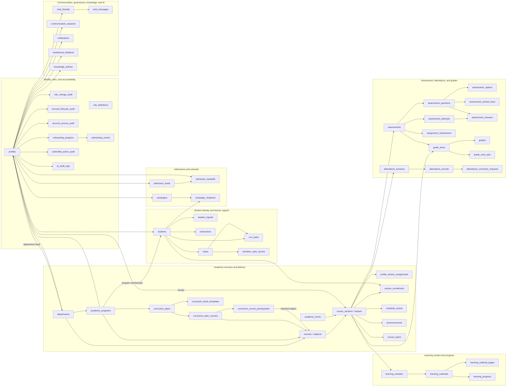

# STU Nexus platform schema map

This map is derived from `src/types/database.generated.ts` and the production migration history. Solid arrows represent persisted foreign keys. Dashed conceptual paths are intentionally resolved through their intermediate records rather than duplicated columns.

## Authoritative academic path

`Department → Program → Curriculum plan → Curriculum subject mapping → Subject → Class section → Term / Faculty → Enrollment → Student`

- A curriculum is already database-linked to exactly one program through `curriculum_plans.program_id`.
- A curriculum subject is linked through `curriculum_plan_courses.plan_id` and `curriculum_plan_courses.course_id`.
- Prerequisites point from a curriculum subject mapping to another subject.
- A class is an offering of one subject in one academic term, optionally assigned to one faculty profile.
- A student reaches a class through `section_enrollments`, and reaches learning, assessment, attendance, schedule, and grades through that class.

## Relationship gaps found before implementation

1. The Academic Office renders programs and curricula in separate lists, hiding their real foreign-key relationship and leaving programs without a visible curriculum state.
2. Subjects show their department but not their optional program, curriculum placement, class offerings, or prerequisite dependents.
3. Classes show subject and term labels but do not expose the complete department/program/curriculum origin or contextual links to roster, schedule, teaching, and assessment workspaces.
4. Student records store a legacy `program` label but no direct `program_id`; a profile can have `program_id`, but SIS-only students cannot be joined reliably. This must be normalized and backfilled.
5. Empty and orphan states do not identify the missing relationship or provide the correct next action.
6. The UI lacks a reusable selected-program context, so actions such as adding a subject or opening a class do not preserve the user’s academic path.

## Intended connected experience

Every department exposes its programs. Every program exposes its curriculum versions, subjects, classes, staff, and students. Every curriculum identifies its owning department and program and exposes the structured subject sequence. Every subject identifies its department, program, curriculum placement, prerequisites, and sections. Every class identifies the originating subject/program, term, teacher, roster, schedule, modules, assessments, attendance, and grade items. Every student identifies the program and active class memberships.
