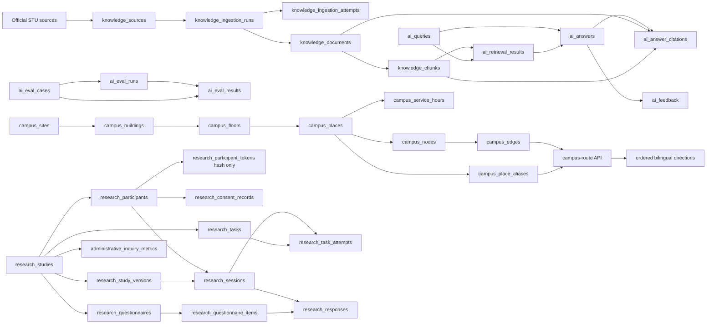

# Research Completion System Schema

This is the implementation map for GitHub Issue #104. It connects the public university information experience, the governed retrieval corpus, campus navigation, answer evidence, evaluation, and empirical study records. It extends—not replaces—the operational school schema documented in `PLATFORM_SCHEMA_MAP.md`.

## Connected architecture

## Domain responsibilities

| Domain | Tables | Production responsibility |
| --- | --- | --- |
| Source governance | `knowledge_sources`, `knowledge_documents`, `knowledge_review_events`, `knowledge_ingestion_runs`, `knowledge_ingestion_attempts` | Allow-listed origins, approval, versioning, freshness, checksum, robots review, bounded retries, dead letters, content-free cost/latency telemetry, and stale-worker recovery |
| Retrieval | `knowledge_chunks` | Stable citation anchors, language/audience scope, lexical vector and 1,536-dimensional semantic vector |
| Answer evidence | `ai_queries`, `ai_answers`, `ai_retrieval_results`, `ai_answer_citations`, `ai_feedback` | Query-to-answer trace, ranked evidence, abstention, citations, user feedback |
| Evaluation | `ai_eval_datasets`, `ai_eval_dataset_versions`, `ai_eval_cases`, `ai_eval_case_reviews`, `ai_eval_runs`, `ai_eval_results` | Checksummed frozen datasets, independently approved gold cases, immutable version-pinned runs, deterministic scorecards, segmented reports, and regression gates |
| Campus graph | `campus_sites`, `campus_buildings`, `campus_floors`, `campus_places`, `campus_place_aliases`, `campus_nodes`, `campus_edges`, `campus_service_hours` | Searchable destinations, multilingual aliases, accessible routing edges, service availability |
| Human study | `research_studies`, `research_study_versions`, `research_participants`, `research_participant_tokens`, `research_consent_records`, `research_tasks`, `research_sessions`, `research_task_attempts`, `research_questionnaires`, `research_questionnaire_items`, `research_responses` | Frozen protocol, pseudonymous participation, hash-only revocable access, consent, counterbalanced task outcomes, questionnaires, SUS and anonymized export |
| Workload | `administrative_workload_windows`, `administrative_inquiry_metrics` | Governed baseline/pilot windows, aggregate inquiry counts, explicit resolution evidence, handling-time totals, independent review, and privacy-safe reporting |

## Trust boundaries

- Anonymous users can read only approved, active, current public source/document metadata and verified active campus entities.
- Anonymous users cannot directly query `knowledge_chunks`, AI traces, evaluation data, study participants, consent, responses, or workload records.
- Public retrieval runs through a server boundary that applies freshness, audience, citation, logging, and abstention rules.
- Authenticated corpus access is narrowed by role, audience, class enrollment, and source/document approval state.
- Participant codes are pseudonymous. Optional contact material is separately encrypted; it is never part of answers, retrieval chunks, or research responses.
- Anonymous participants have no direct study-table privileges. `/study/:code` uses an HttpOnly token; the database stores only its SHA-256 hash, validates active consent and exact protocol relationships on every write, and revokes it on withdrawal.
- Every table has RLS enabled and explicit Data API privileges. Database policies remain the authorization authority.

## Relationship invariants

1. A chunk cannot exist without a versioned document; a document cannot exist without a governed source.
2. A citation points to the exact document and optional chunk used for the answer.
3. Campus edges join valid graph nodes and carry accessibility constraints, distance, operating windows, closure state, and reviewed forward/reverse directions. The public router excludes unverified records before deterministic path selection.
4. An attempt joins one protocol-versioned session to one defined task.
5. A questionnaire response joins a session, questionnaire, and item from the study model.
6. Evaluation results belong to both a version-pinned run and an eligible case in its frozen checksummed dataset. A case cannot become eligible without two distinct approvals from reviewers other than its author; frozen cases, reviews, terminal runs, and results are immutable.
7. Protected research and retrieval data is not exposed to the anonymous Data API role.
8. A study cannot recruit through the participant boundary until its selected protocol version is frozen; balanced assignment is serialized per version, and analysis export emits irreversible study-scoped pseudonyms rather than database or production identities.
9. Administrative workload windows for one office cannot overlap, baseline/pilot durations must match, category totals must reconcile to the governed source count, and a different authorized reviewer must verify the evidence.
10. An AI answer is never a confirmed resolution. Aggregate observations require an explicit confirmation evidence type/count, remain append-only after entry, and report categories below the approved threshold only as a suppressed cell.
11. An ingestion attempt cannot exceed its run's retry ceiling, and attempt two or later is valid only after the immediately preceding attempt ended as a transient failure. Permanent failures are never retried; abandoned workers are quarantined rather than silently reported as complete.

## Ingestion operations boundary

Each governed import records deterministic parser/chunker/model versions, terminal status, chunk and token totals, duration, configured-cost state, bounded attempts, privacy-safe failure classification, and a SHA-256 provider request identifier when available. Raw source text, prompts, credentials, provider response bodies, and request identifiers are prohibited from operational telemetry. Owner, administrator, and librarian roles may inspect the 30-day aggregate health summary and quarantine stale work; anonymous and ordinary student accounts cannot read attempt rows or invoke recovery.

URL acquisition permits only credential-free HTTPS on the standard port, rejects local/private/link-local/reserved addresses before and during connection, manually revalidates redirects, keeps the final host inside the governed source host, and bounds time and bytes. Pinned HTML and PDF parsers remove executable/hidden content and preserve heading, element, table/form, link, and page provenance in each stable chunk locator. Uploaded files additionally pass declared-MIME/signature checks and a serverless-safe 3 MB request limit; remote sources are capped at 4 MB.

Every acquired version remains inactive and invisible to the public until metadata, exact chunks, source link, effective/review dates, and lineage are reviewed. The database records reasoned publish, change-request, rejection, quarantine, and rollback decisions atomically. Quarantined/rejected drafts never activate chunks, and ordinary students cannot edit sources, documents, chunks, or review decisions.

## Administrative workload evidence boundary

The Analytics workspace no longer displays invented deflection, satisfaction, or intervention percentages. Authorized office and research roles can enter aggregate baseline/pilot observations linked to an approved study, while the browser calculates a SHA-256 checksum over the submitted aggregate payload. Names, emails, student numbers, message bodies, and respondent-level records are prohibited.

The database rejects overlapping or unequal-duration comparison windows, creator self-verification, unreconciled source totals, inferred resolution, observation mutation, and anonymous/student access. The report supplies denominators and descriptive counts, suppresses small cells, and always keeps `claimPermitted=false`. Only an approved STU pilot analysis with uncertainty and participating-office sign-off can support a workload-reduction claim.

## Campus validation boundary

The deployed router proves graph behavior; it does not prove the physical campus is represented correctly. Only source-owned, dated places and verified edges are eligible. Routes always include an ordered text alternative and an explicit notice that posted signs prevail until an authorized STU owner completes the recorded on-campus walkthrough. Issue #118 tracks implementation evidence; physical sign-off remains external on Issue #110.
