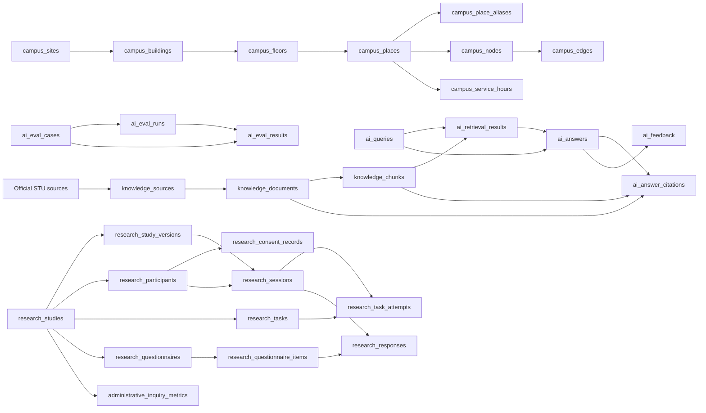

# Research Completion System Schema

This is the implementation map for GitHub Issue #104. It connects the public university information experience, the governed retrieval corpus, campus navigation, answer evidence, evaluation, and empirical study records. It extends—not replaces—the operational school schema documented in `PLATFORM_SCHEMA_MAP.md`.

## Connected architecture

## Domain responsibilities

| Domain | Tables | Production responsibility |
| --- | --- | --- |
| Source governance | `knowledge_sources`, `knowledge_documents`, `knowledge_review_events`, `knowledge_ingestion_runs` | Allow-listed origins, approval, versioning, freshness, checksum, robots review, ingestion audit |
| Retrieval | `knowledge_chunks` | Stable citation anchors, language/audience scope, lexical vector and 1,536-dimensional semantic vector |
| Answer evidence | `ai_queries`, `ai_answers`, `ai_retrieval_results`, `ai_answer_citations`, `ai_feedback` | Query-to-answer trace, ranked evidence, abstention, citations, user feedback |
| Evaluation | `ai_eval_cases`, `ai_eval_runs`, `ai_eval_results` | Versioned gold cases and reproducible retrieval/answer scorecards |
| Campus graph | `campus_sites`, `campus_buildings`, `campus_floors`, `campus_places`, `campus_place_aliases`, `campus_nodes`, `campus_edges`, `campus_service_hours` | Searchable destinations, multilingual aliases, accessible routing edges, service availability |
| Human study | `research_studies`, `research_study_versions`, `research_participants`, `research_consent_records`, `research_tasks`, `research_sessions`, `research_task_attempts`, `research_questionnaires`, `research_questionnaire_items`, `research_responses` | Protocol version, pseudonymous participation, consent, task outcomes, questionnaires |
| Workload | `administrative_inquiry_metrics` | Pre/post inquiry volume and handling-time evidence by office/category/period |

## Trust boundaries

- Anonymous users can read only approved, active, current public source/document metadata and verified active campus entities.
- Anonymous users cannot directly query `knowledge_chunks`, AI traces, evaluation data, study participants, consent, responses, or workload records.
- Public retrieval runs through a server boundary that applies freshness, audience, citation, logging, and abstention rules.
- Authenticated corpus access is narrowed by role, audience, class enrollment, and source/document approval state.
- Participant codes are pseudonymous. Optional contact material is separately encrypted; it is never part of answers, retrieval chunks, or research responses.
- Every table has RLS enabled and explicit Data API privileges. Database policies remain the authorization authority.

## Relationship invariants

1. A chunk cannot exist without a versioned document; a document cannot exist without a governed source.
2. A citation points to the exact document and optional chunk used for the answer.
3. Campus edges join valid graph nodes and carry accessibility constraints and distance.
4. An attempt joins one protocol-versioned session to one defined task.
5. A questionnaire response joins a session, questionnaire, and item from the study model.
6. Evaluation results belong to both a run and a versioned gold case.
7. Protected research and retrieval data is not exposed to the anonymous Data API role.
